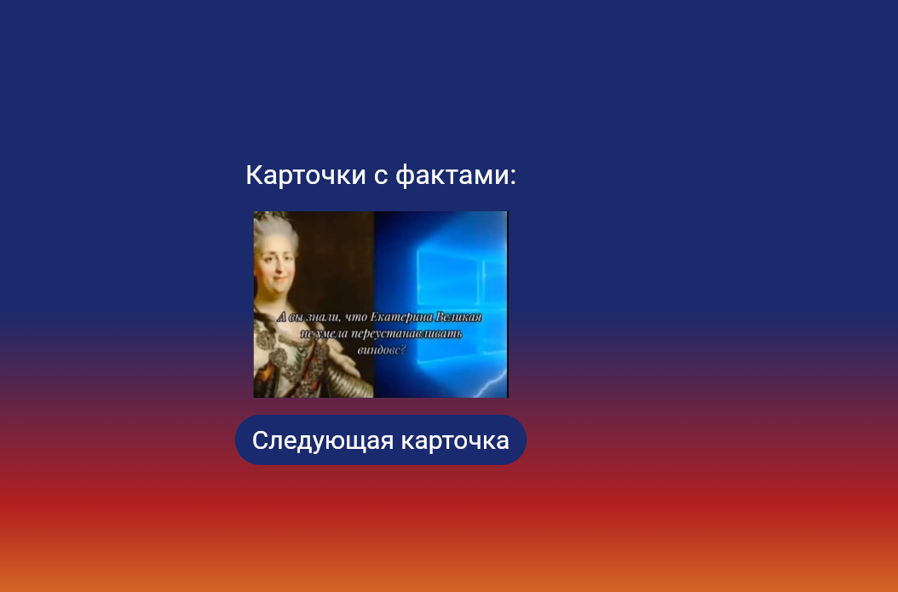
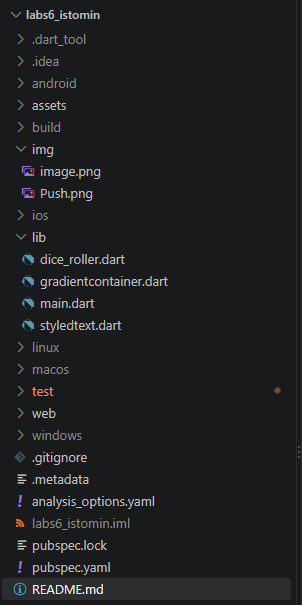

# Карточки с фактами

**Тема:** Приложение показывает случайный интересный факт истории при нажатии кнопки. 
Приложение реализует интерактивный интерфейс с градиентным фоном, динамической сменой карточки по клику на кнопку.

## Автор

* **Автор:** Истомин Максим 
* **Группа:** ИСП-243
* **Дата:** 23.10.26

## Стек и версии

* **Flutter:** 3.47.7
* **Dart:** 3.13.4
* **Платформа:** edge
* **IDE:** VS Code

## Скриншот приложения



## Структура проекта



labs6_istomin


## Как запустить

Выполните следующие команды в терминале:

```
git clone https://github.com/krekerfit1/lab6_Flutter.git
cd labs6_Istomin
flutter run -d chrome